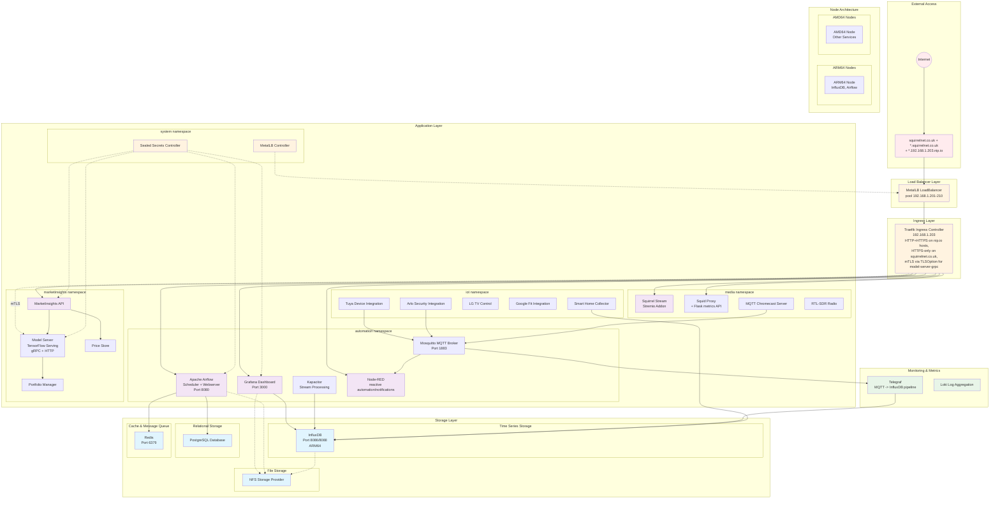

# Smart Home Kubernetes Deployment Architecture

## Architecture Diagram

## Architecture Summary

### Infrastructure Layers
1. **External Access**: Domain routing through squirrelnet.co.uk
2. **Load Balancing**: MetalLB providing IPs 192.168.1.201-210  
3. **Ingress**: Traefik handling TLS termination and routing — plain HTTP and HTTPS on nip.io hosts, HTTPS-only on `squirrelnet.co.uk` subdomains/paths, and mutual TLS (via a `TLSOption` + `IngressRoute`) for the model-server gRPC endpoint
4. **Applications**: Multi-namespace deployment across different domains

### Key Components
- **Data Pipeline**: Airflow orchestrates ETL jobs with CeleryKubernetesExecutor
- **Monitoring Stack**: Grafana + InfluxDB + Kapacitor for time-series visualization
- **Automation**: Telegraf (MQTT → InfluxDB structural pipeline) and Node-RED (reactive branching/fan-out, e.g. MQTT-triggered notifications) — see [Automation Styles](#automation-styles) below for how these differ from Airflow and from serverless functions
- **IoT Hub**: Mosquitto MQTT broker connecting various smart home devices
- **Market Analytics**: Dedicated namespace for financial data processing, including a gRPC endpoint protected by mutual TLS
- **Storage**: Multi-tier with InfluxDB (time-series), PostgreSQL (relational), Redis (cache), Loki (logs)

### Node Architecture
- ARM64 nodes for specific workloads (InfluxDB, Airflow)
- Mixed architecture deployment with node selectors
- Persistent storage via NFS provisioner

### Namespaces
- `system`: Traefik (ingress controller, holds `192.168.1.203`), MetalLB controller, Sealed Secrets controller, Democratic CSI, NFS provisioner
- `automation`: Grafana, Airflow (scheduler + worker), Kapacitor, Node-RED, Mosquitto MQTT broker
- `marketinsights`: MarketInsights API, Model Server (TensorFlow Serving, gRPC+HTTP), Portfolio Manager, Price Store
- `media`: Squid proxy, Squirrel Stream (Stremio addon), MQTT Chromecast server
- `iot`: Smart Home Collector, Tuya, LG TV, Google Fit integrations
- `storage`: InfluxDB, PostgreSQL, Redis, Loki
- `actions`: legacy/unused — superseded by `automation`, kept only because it still exists in the cluster

The cluster demonstrates enterprise-grade patterns with proper namespace isolation, secret management via Sealed Secrets, and comprehensive monitoring across all layers.

## Automation Styles

The lab uses four distinct automation/integration patterns, each suited to a different shape of problem rather than being interchangeable. The deciding question for a new integration is: does every instance take the same path (Telegraf), does it need a decision (Node-RED), is it a reusable callable unit (serverless), or is it a multi-step pipeline (Airflow)?

| Style | Representative Tool | Trigger / Shape | Strengths | Weaknesses | Example in this lab |
|---|---|---|---|---|---|
| **Structural data pipeline** | Telegraf | Continuous, same path every message — declarative input → processor → output plugins, no branching | Purpose-built for high-volume, schema-consistent telemetry; minimal per-message overhead; config-driven, no custom code | No branching/decision logic, no fan-out to heterogeneous destinations | Reading MQTT messages and writing them straight into InfluxDB |
| **Reactive branching/fan-out** | Node-RED | Event-driven (MQTT, webhook, timer) where the response involves a decision and/or multiple destinations | Visual/low-code; large library of integration nodes; fast to wire up heterogeneous fan-out | Flows are JSON blobs (poor git diff/review); not great for complex logic, retries, or heavy computation | Generating notifications from MQTT events and fanning them out to multiple destination platforms |
| **Reusable callable unit** | Serverless function (OpenFaaS) | Synchronous request/response — given input, compute/transform/fetch and return a result | Independently versioned and scaled; code-first (real tests/CI/git history); callable by multiple consumers (apps, MCP tools, Node-RED itself) | No built-in orchestration, retries, or dependency handling between steps | (Planned) general-purpose API functions callable by multiple consumers in the lab |
| **Multi-step orchestration** | Airflow | Scheduled and/or triggered via its API — multi-step pipeline with dependencies between steps | Retries/backoff, dependency graphs, historical run visibility/audit trail; suited to batch/ETL work | Not low-latency — triggering via API returns a run ID, not an inline result; heavier than the task warrants for simple actions | Scheduled ETL jobs for market-insights data via `CeleryKubernetesExecutor` |

These aren't mutually exclusive — a common pattern is layering them, e.g. Node-RED reacting to an event and calling a serverless function to do the actual unit of work, or an Airflow task itself invoking a serverless function as one orchestrated step. The question is which one is acting as the orchestrator and which is doing the actual work, not which single tool to use exclusively.