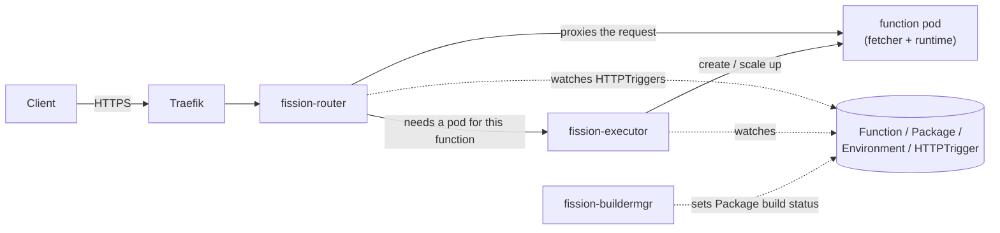

# Fission on the cluster

[Fission](https://fission.io) (v1.27.0) runs small HTTP functions on the single k3s node, with scale-to-zero. It is installed from plain YAML applied with `kubectl`; Helm is only used to render that YAML. The control plane lives in the `automation` namespace, and functions, environments, packages and triggers live in `services`.

This document explains what is deployed (and what deliberately isn't), how the YAML is generated, and how code gets from a GitHub release into a function.

## Architecture

### Request flow



1. Traefik forwards the request to the `router` Service.
2. The router matches the path against the `HTTPTrigger` resources and asks the executor for a pod for that function.
3. If none is running, the executor creates or scales one up and the pod's fetcher loads the code (a cold start, typically 2-3 seconds).
4. The router proxies the request to the pod. After `idletimeout` seconds without requests, the executor scales an idle function back to zero.

Everything Fission knows about functions lives in custom resources, so deploying a function is applying YAML.

### Pods

Deployed. Deployment names are prefixed `fission-` because the namespace is shared with other applications.

| Pod | Role |
|---|---|
| `fission-router` | HTTP entry point: matches paths to `HTTPTrigger`s and proxies to function pods |
| `fission-executor` | Creates, specializes, scales and reaps function pods; runs the idle reaper that scales to zero |
| `fission-buildermgr` | Builds source packages **and sets `status.buildstatus` on every Package**, even when nothing is built. A new Package without a build status is rejected by the fetcher (`package build status was not "succeeded"`), so this pod is required even though no builds happen in the cluster |

Function pods run in `services` and each has two containers: the **fetcher** (downloads and unpacks the code, then tells the runtime to load it) and the **runtime** (the language environment, or your own image for the container executor).

Not deployed. Their manifests are rendered into `optional/`; apply a file to turn the component on.

| Component | What it does | Why it isn't deployed |
|---|---|---|
| `webhook-server` | Admission webhook that validates and defaults Fission resources | Not needed: the CRDs carry their own validation (CEL rules in the schema, for example the allowed executor types). Its configurations are `failurePolicy: Fail` and it needs a serving certificate. To enable it, apply the sealed `fission-webhook-certs` in `secrets/` first, then `optional/webhook-server.yaml` (delete it as a whole file, because removing the pod while the configurations remain blocks every Fission change) |
| `storagesvc` | In-cluster archive store, used by CLI uploads and `buildermgr` output | Not needed for `literal` and `url` packages. Would need a PVC (`persistence`); with the default `emptyDir`, archives are lost when the pod restarts |
| `timer` | Fires functions on a schedule (`TimeTrigger`) | Not used |
| `kubewatcher` | Fires functions on Kubernetes object changes | Not used |
| `mqt-keda`, `mqt-fission-kafka`, `fluentbit` | RBAC only (ServiceAccount and Roles): the chart renders these even though the features are disabled in `helm-values.yaml`, because only their Deployments are gated | The features (KEDA and Kafka message-queue triggers, InfluxDB log shipping) are off |

Also off in `helm-values.yaml`: canary deployments, analytics, Fission's internal auth, and persistence. The chart's pre-upgrade hook resources and its Secrets are dropped when rendering.

### Custom resources

| Resource | Purpose |
|---|---|
| `Environment` | A language runtime image (Python, Node, ...) used to run function code, with an optional warm-pool size |
| `Package` | The code: embedded (`literal`), or fetched from a `url` with a sha256 |
| `Function` | Ties an Environment and a Package (or, for the container executor, a pod spec) to an executor and scaling settings |
| `HTTPTrigger` | Maps a path (`prefix` or `relativeurl`) and methods to a Function |

There are also `TimeTrigger`, `KubernetesWatchTrigger`, `MessageQueueTrigger` and `CanaryConfig`, none of which are used.

### Executors

Set per function in `spec.InvokeStrategy.ExecutionStrategy.ExecutorType`.

| Executor | How it runs | Scaling | Cold start |
|---|---|---|---|
| `poolmgr` | Loads the function into a pre-warmed generic pod from the Environment's pool (`poolsize`) | The function pod is recycled after `idletimeout`, but the warm pool pods stay, so there is no true zero | Fast (about 1 second to specialize) |
| `newdeploy` | Gives the function its own Deployment and HPA | `MinScale: 0` scales to zero after `idletimeout` | 2-3 seconds |
| `container` | Runs an arbitrary image from `spec.podspec`, with no code loading or fetcher. Use it to front an existing image | Same as `newdeploy` | Pod start plus the app's own boot time |

Notes:
- For `newdeploy` and `container`, a Function created with `MinScale: 0` gets one replica immediately and is reaped to zero after the idle timeout; zero was reached about 50-130 seconds after the last request, depending on `idletimeout` and the reaper's interval.
- Streaming responses (SSE, chunked, long-lived) need `spec.streaming`: it makes the router flush every write, replaces the single `FunctionTimeout` with an idle timeout (default 60 s, reset by every chunk) and an optional maximum duration, and keeps the pod alive for the connection. Without it the classic buffered path with a 60-second total timeout applies.
- A function image must be pullable by the node and built for amd64.

### How code reaches a function pod

| Delivery | Use for |
|---|---|
| `literal` Package | Tiny functions: the code is base64 in the Package. The CRD suggests staying under about 256 KB, and a Kubernetes object has a size limit (about 1.5 MiB) |
| `url` Package + `checksum` | Anything larger. Code is built outside the cluster, published at a URL, and referenced with its sha256. See "Packages from GitHub releases" below |
| `source` Package + `buildcmd` | Built in the cluster by `buildermgr` and stored in `storagesvc`. Not used here |
| `oci` Package | Code as an OCI image in a registry. Not used here |
| `container` executor | Your own image, no Package at all |

How the fetcher treats a `url` Package (from `pkg/fetcher/fetcher.go`):
- **Every new pod downloads the archive again.** The only cache is a skip-if-the-file-is-already-in-this-pod's-volume check, so a cold start or an extra replica fetches it again. Large archives lengthen cold starts, and each cold start depends on the host (GitHub) being reachable.
- **sha256 is verified** after the download when `checksum.sum` is set, and the fetch fails on a mismatch. It is skipped if `sum` is empty.
- HTTP redirects are followed (GitHub release assets redirect to a CDN host). There is no way to send credentials, so the URL has to be publicly readable.

### Validation, auth and exposure

- **Validation** comes from the CRD schemas, not a webhook. An invalid executor type, for example, is rejected on apply.
- **Fission's internal auth is off** (`internalAuth.enabled: false`): the shared-HMAC signing between its own components isn't needed on a single trusted node. Gotcha: a function pod's fetcher reads a token from a `fission-internal-auth` Secret in its own namespace, marked optional. If one is left in `services`, the fetchers enforce auth while the executor no longer signs, and poolmgr specialization fails with `401 Unauthorized` (a 500 `specialization_failed` from the router). Delete the Secret and recreate the function pods.
- **Fission has no caller authentication.** Anything that can reach the router can call every function that has an `HTTPTrigger`. Exposure is therefore a Traefik decision: see the Traefik ingress files in `workloads/traefik/ingress/` (HTTPS only; the router is a lowest-priority catch-all route on the API host, so a function path that starts with one of the existing API prefixes is shadowed and never reaches Fission). The router also answers `/_version`, `/router-healthz`, `/readyz` and `/`. Keep it LAN-only.
- Functions that need a credential read it from a Secret in `services` (an environment variable on the container). Secrets are sealed with `kubeseal`; a sealed secret is bound to its name and namespace, so one in another namespace cannot be reused here, and a dedicated per-function secret avoids exposing unrelated keys.

### Namespaces, naming and footprint

- Control plane: `automation` (already exists). Functions and their resources: `services` (defined in `namespaces/namespaces.yaml`).
- The chart leaves `metadata.namespace` off Deployments and Services; the generator adds it. Service names stay as the chart names them (`router`, `executor`, ...) because Fission finds its components by those names.
- The three control-plane pods use about 45-60 MiB in total. A Python function pod uses about 40 MiB.

## Repository layout

```
generate-yamls.sh   renders install/ and optional/ from the Fission Helm chart
helm-values.yaml    chart values (see "Control plane" below)
install/            the control plane that is deployed: router, executor, buildermgr, misc-functions (shared RBAC and ConfigMap)
optional/           components that are rendered but not deployed (see "Pods")
secrets/            the sealed webhook certificate, only needed if the webhook is enabled
example/            demo manifests: an Environment, a poolmgr function, a newdeploy scale-to-zero function,
                    and a url Package built from a GitHub release (functions/hello.py is the source of the literal ones)
```

Related, outside this directory: `secrets/cert/fission/generate-secrets.sh` (creates the webhook CA and certificate and seals it), and the CRDs, which come from the Fission repository rather than the chart.

## Generating the YAML

### Control plane: `generate-yamls.sh`

`helm template` on the `fission-all` chart (1.27.0) with `helm-values.yaml`, then post-processed into one file per chart template directory.

`helm-values.yaml` sets: the router Service to `ClusterIP`; `defaultNamespace: services`; persistence, analytics, KEDA, Kafka, InfluxDB logging, canary and internal auth all off.

What the script does:
1. Applies the sealed secrets in `secrets/`, waits for the sealed-secrets controller to unseal `fission-webhook-certs`, and reads its public `ca.crt` from the cluster.
2. Renders the chart with that CA passed as `webhook.crtPEM` (the chart reuses it as the webhooks' `caBundle`).
3. Drops the chart's own Secrets and pre-upgrade hook resources.
4. Prefixes each Deployment name with `fission-` and adds `metadata.namespace` where the chart omitted it.
5. Writes one file per chart template directory into `install/` or `optional/`, according to the `OPTIONAL` list at the top of the script. Edit that list to move a component.

Requires `helm` and `kubectl` with cluster access, and the namespaces must already exist. Re-run it to change the chart version, `helm-values.yaml` or the `OPTIONAL` list, and commit the result.

Why not commit a plain `helm template`: the chart generates its webhook CA twice, once for the Secret and once for the webhook configurations, so the output is internally inconsistent and the webhook fails with `x509: certificate signed by unknown authority`. Rendering with the CA from the live Secret avoids that. The webhook is not deployed, but the generator still reads that Secret, so it must exist.

### Functions, environments and triggers: the Fission CLI as a generator

The CLI is used only to print YAML, never to deploy. Run without a flag, `fission fn create` and `run-container` create resources directly on the cluster, which bypasses `kubectl apply`.

Install the v1.27.0 binary (matching the control plane). Homebrew has no formula for it: `brew install fission` installs an unrelated audio editor.

```bash
cd "$(mktemp -d)"
B=https://github.com/fission/fission/releases/download/v1.27.0
curl -sSfLO $B/fission-v1.27.0-darwin-arm64 && curl -sSfLO $B/checksums.txt
grep 'fission-v1.27.0-darwin-arm64$' checksums.txt && shasum -a 256 fission-v1.27.0-darwin-arm64   # must match
chmod +x fission-v1.27.0-darwin-arm64 && sudo mv fission-v1.27.0-darwin-arm64 /usr/local/bin/fission
```

Generate, then apply with `kubectl`:

```bash
# a function that runs an existing image (container executor)
fission fn run-container --name <name> --namespace services --image <image>:<tag> --port <port> \
  --minscale 0 --maxscale 2 --idletimeout 120 --graceperiod 10 \
  --mincpu 20 --maxcpu 250 --minmemory 32 --maxmemory 128 --dry > function.yaml

# its HTTP trigger
fission route create --name <name> --function <name> --namespace services --prefix /<path> \
  --method GET --method POST --dry > trigger.yaml
```

- `--dry` prints the spec. `--spec` writes it to a `specs/` directory instead (run `fission spec init` first). Neither creates anything.
- `--dry` refuses if a function of that name already exists on the cluster ("a function with the same name already exists"); `--spec` skips that check.
- The CLI prints a `Warning: function(s) ... not present` line to **stdout** when the function isn't on the cluster yet; delete it from the captured file.
- The CLI emits the empty `environment` and `package` objects the Function CRD requires, which is why hand-written Function YAML often fails validation. Starting from CLI output avoids that.
- The CLI has no flags for some pod settings (environment from a Secret, volumes, probes, a security context, `spec.streaming`). Add those by hand and mark them with a `# added by hand` comment, and put the exact CLI commands in the file's header so it can be regenerated.
- `Environment` and small `literal` or `url` Package manifests are short enough to write directly; see `example/`.

### ConfigMaps and Secrets

- ConfigMaps from a source file, so the file stays the source of truth: `kubectl create configmap <name> --namespace services --from-file=<file> --dry-run=client -o yaml > configmap.yaml`. Put that command in the source file's header comment, and regenerate after every edit.
- Secrets are sealed (`kubeseal --format yaml`) into the namespace that uses them. Consumed as environment variables via `secretKeyRef`. Never commit the plaintext.

### Packages from GitHub releases

For code too large for a `literal`, the code lives in its own repository, is built by GitHub Actions, and each build becomes a release whose assets include a ready-made Fission manifest. The reference implementation is `github.com/cwilko/test_package` (it must be public, since the fetcher cannot authenticate).

Repository contents:

| File | Role |
|---|---|
| `main.py` | The function: module `main`, function `main` (the Python environment imports `module.function`, default `main.main`, with the unpacked archive on `sys.path`) |
| `requirements.txt` | Dependencies, vendored into the archive at build time |
| `build.sh` | `GITHUB_REPOSITORY=owner/repo ./build.sh <version>` produces `dist/<name>-<version>.zip`, its `.sha256`, and `dist/package.yaml` |
| `fission/package.yaml.tmpl` | Template for the Package, Function and HTTPTrigger; `build.sh` fills in the URL, sha256 and names (`FISSION_NAMESPACE` and `FISSION_ENVIRONMENT` default to `services` and `python`) |
| `scripts/prune-dev-releases.sh` | Deletes old development pre-releases |
| `.github/workflows/release.yml` | The pipeline below |

What the workflow does:

| Event | Version | Result |
|---|---|---|
| pull request | `ci-<sha>` | builds only, publishes nothing |
| push to `main` | `dev-<short sha>` | a GitHub **pre-release**, then prunes old `dev-*` pre-releases, keeping the newest 5 (`KEEP_DEV_RELEASES`); it only ever selects pre-releases whose tag starts with `dev-` |
| push of a `v*` tag | the tag | a normal release |

Each release has three assets: `<name>-<version>.zip` (the code with dependencies at the zip root), `<name>-<version>.zip.sha256`, and `package.yaml` (Package with the asset URL and sha256, a Function, and an HTTPTrigger).

Using it:

```bash
gh release list --repo <owner>/<repo>                    # dev builds are marked Pre-release
gh release download <tag> --repo <owner>/<repo> --pattern package.yaml --output package.yaml
kubectl apply -f package.yaml
```

Rules:
- **Pure-Python dependencies only.** The Python environment runs on `python:3.13-alpine` (musl), so compiled wheels won't load; `build.sh` installs with `--only-binary=:all:` and fails if the archive contains any `.so`.
- **Dependencies sit at the zip root**, next to `main.py`.
- **Every build has its own immutable URL and checksum**, so a Package never changes underneath you.
- **Dev builds are pruned.** A Package that points at a pruned `dev-<sha>` URL cannot fetch its code at its next cold start. Tag a `v*` release for anything that has to stay deployed.
- The fetcher downloads on every cold start (see "How code reaches a function pod").

## Deploying

First install:

```bash
# 1. CRDs (not part of the chart)
kubectl apply --server-side -k "github.com/fission/fission/crds/v1?ref=v1.27.0"

# 2. Namespaces: automation already exists; services is in namespaces/namespaces.yaml
kubectl apply -f ../../namespaces/namespaces.yaml

# 3. Control plane (regenerate first with ./generate-yamls.sh if anything changed)
kubectl apply -f install/

# 4. Expose the router through Traefik (see workloads/traefik/ingress/)
```

Adding a function: write or generate the manifests (`Environment` once per runtime, then the `Package` if any, `Function` and `HTTPTrigger`), then `kubectl apply -f`. Check:

```bash
kubectl get environment,package,function,httptrigger -n services
kubectl get package <name> -n services -o jsonpath='{.status.buildstatus}'   # expect: none
kubectl get pods -n automation | grep fission-                               # control plane
kubectl get pods,deploy -n services                                          # function pods (none while scaled to zero)
```

Updating code in a `url` Package: apply the new release's `package.yaml` (new URL and checksum).

Uninstalling: **delete functions first, while the control plane is still running.** Fission resources carry finalizers handled by its own controllers, so removing the control plane first can leave them, and their namespace, stuck deleting.

```bash
kubectl delete -f <function manifests>
kubectl delete -f install/            # plus optional/<file> for anything optional you applied
kubectl delete -k "github.com/fission/fission/crds/v1?ref=v1.27.0"
```

## Troubleshooting

| Symptom | Cause |
|---|---|
| 500 from the router, executor log `package build status was not "succeeded"` | `fission-buildermgr` isn't running, so new Packages have no build status |
| 500 `specialization_failed`, executor log `401 Unauthorized` | A stray `fission-internal-auth` Secret in `services` (see "Validation, auth and exposure") |
| `x509: certificate signed by unknown authority` on applying Fission resources | Only with the webhook enabled: the chart's CA and `caBundle` don't match (use `generate-yamls.sh`) |
| `fission fn run-container --dry` says the function already exists | Use `--spec`, or generate before the function is applied |
| Function path returns another application's response or a 404 from Traefik | The path starts with an existing API prefix on the shared host, so Traefik never sends it to Fission |
| Function pods won't start from a `readOnlyRootFilesystem` container | The app needs writable scratch directories; mount `emptyDir` volumes for them |
| Cold start is slow | Pod start, image pull on a new node, the archive download, and the runtime's own boot all count; keep `MinScale: 1` for functions that must always be warm |

## Known gaps

- Not exercised: how Fission rolls out a changed Package URL (a new release applied over an old one), and rejection of a wrong checksum (the fetcher source says it fails).
- Not exercised: a client holding a long-lived stream open, and whether a live stream stops the pod being scaled to zero.
- `storagesvc` with a PVC, the source-build path, and the `oci` Package type have not been tried.
